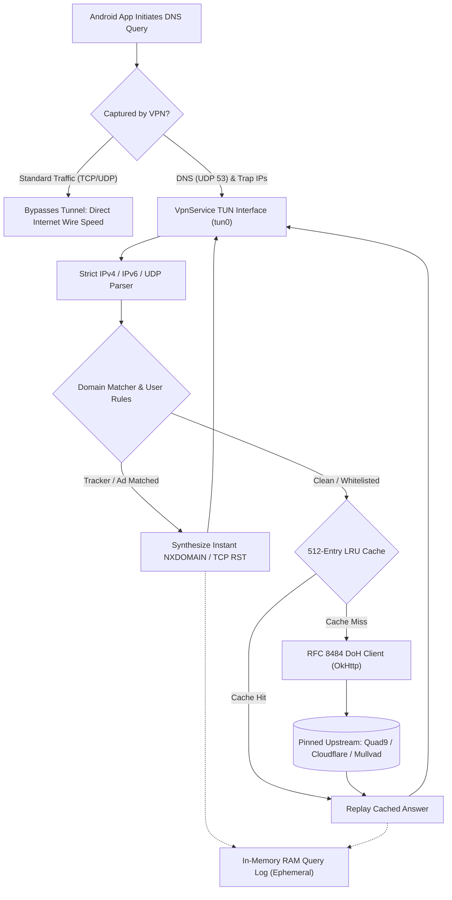

<div align="center">


# Wallupus

**A minimal, uncompromising DNS-only ad and tracker blocker for Android 10+**

<p>
  <a href="https://github.com/projectGloria/Wallupus/releases"></a>
  
  
  
  
  
</p>

<p align="center">
  
</p>

<p align="center">
  <a href="#about">About</a> •
  <a href="#features">Features</a> •
  <a href="#interface-tour">Interface Tour</a> •
  <a href="#architecture">Architecture</a> •
  <a href="#installation">Installation</a> •
  <a href="#usage">Usage</a> •
  <a href="#configuration">Configuration</a> •
  <a href="#codebase-map">Codebase Map</a> •
  <a href="#building-from-source">Building from Source</a> •
  <a href="#known-limits">Known Limits</a> •
  <a href="#design-philosophy">Design Philosophy</a> •
  <a href="#privacy-and-license">Privacy and License</a>
</p>

</div>

---

## About

**Wallupus** is a lean, transparent, local DNS sinkhole and tracker blocker built for Android 10+ (API 29+). Operating without external cloud intermediaries or heavy local proxy daemons, it intercepts DNS packets directly on-device using a lightweight `VpnService` TUN interface while letting all normal TCP and UDP data traffic pass through at full wire speed.

Permitted lookups resolve securely via DNS-over-HTTPS (RFC 8484) with pinned bootstrap IPs to eliminate plain-text ISP observation, while filter lists compile locally into compact 64-bit hash tables for sub-millisecond evaluation. The entire codebase is approximately 4,700 lines of clean, audit-friendly Kotlin with zero analytics, zero third-party telemetry, and an ephemeral in-memory query log that leaves no trace on disk.

---

## Features

- **Pure DNS Interception**: Only port 53 DNS queries and public resolver trap addresses enter the local VPN tunnel. Web browsing, video streaming, game traffic, and file downloads bypass Wallupus completely, ensuring zero throughput throttling and minimal battery drain.
- **RFC 8484 DNS-over-HTTPS**: Encrypted upstream queries with pinned bootstrap IPs so your ISP never observes the resolver's hostname. Seamlessly switches between Quad9 (default), Cloudflare, Cloudflare Security, Mullvad, Mullvad Base, AdGuard, Google, or custom DoH endpoints without dropping the VPN.
- **Sub-Millisecond Suffix Matching**: Evaluates queries using binary search over sorted 64-bit FNV-1a domain hashes with zero per-packet heap allocations. Blocked domains receive instant synthetic `NXDOMAIN` answers and immediate TCP `RST` generation on ports 443 and 853.
- **Per-App Query Attribution**: Resolves socket ownership in real time before answering queries via `ConnectivityManager.getConnectionOwnerUid()`. Displays requesting application names and icons directly inside the live query log.
- **Zero-Disk Ephemeral Logging**: Query history lives exclusively in volatile RAM (capped at 20,000 app-domain groups) and is destroyed on process exit. Consolidates repeat queries with live hit counters and allows instant one-tap allow/block rule creation.
- **Resilient On-Device List Engine**: Downloads and compiles `hosts`, raw domain lists, and Adblock `||domain^` syntax locally. Automated background updates (via Android `WorkManager`) use conditional HTTP GETs (ETag / Last-Modified), a 64 MB download ceiling, anti-shrink safeguards (>75% drop rejection), and corrupt-safe atomic file replacement.
- **Dual Independent Switches**: Ad/tracker blocking and encrypted DNS operate as independent controls. The local tunnel remains active whenever either capability is turned on.

---

## Interface Tour

Wallupus features an AMOLED dark theme (`#0E0A0B` obsidian with `#D11F40` crimson accents) built with Jetpack Compose and Material 3:

<p align="center">
  
  <br />
  <em>Wallupus interface: <strong>Home</strong> status shield and toggle switches, <strong>Query Log</strong> with per-app attribution and one-tap whitelisting, <strong>Blocklists</strong> subscription manager, and <strong>Settings</strong> with live-probed DoH upstreams.</em>
</p>

1. **Home Screen**: A glowing shield button indicates real-time protection state. Quick status chips display current query throughput and active upstream resolver.
2. **Query Log**: Live feed of domain lookups grouped by requesting application. Tracker blocks are highlighted in crimson, clean lookups in emerald, and tap actions open immediate allow/block rule options.
3. **Blocklists**: Manage filter sources (StevenBlack Unified, AdGuard DNS filter, HaGeZi Multi Pro, and DoH bypass lists), trigger on-demand compilation, and monitor active rule counts.
4. **Settings Screen**: Switch between zero-logging DoH providers or configure a custom resolver with custom bootstrap IPs, protected by automatic pre-flight connectivity verification.

---

## Architecture

Wallupus operates as a lightweight packet processing engine directly over the Android `VpnService` TUN interface (`tun0`):

<p align="center">
  
  <br />
  <em>Wallupus architecture: only DNS queries enter the tun0 interface, while standard TCP/UDP traffic bypasses the tunnel at wire speed.</em>
</p>

### Packet Lifecycle



1. **Trap Routes**: `WallupusVpnService` configures routes strictly for its synthetic loopback resolvers (`10.254.1.1`, `fd00::1`) and known public DNS anycast IPs (`8.8.8.8`, `1.1.1.1`, etc.).
2. **Packet Polling**: A dedicated worker thread polls `tun0` using `Os.poll()` alongside a self-pipe wake mechanism. Non-DNS TCP probes (e.g. DoT on port 853 or hardcoded DoH on port 443) receive instant synthetic TCP resets (`RST`).
3. **Domain Evaluation**: The query domain name is extracted without heap allocations and tested against sorted 64-bit FNV-1a hash arrays. Custom user rules take priority over downloaded blocklists.
4. **Upstream Forwarding**: Allowed lookups consult an in-memory 512-entry unaged LRU cache. Cache misses dispatch as RFC 8484 binary POST payloads over OkHttp to the active DoH resolver.
5. **App Identification**: Socket UIDs are queried via `ConnectivityManager.getConnectionOwnerUid()` before the answer packet writes back to the tunnel, resolving package metadata via Android's package manager.

---

## Installation

### Requirements

- **Android 10+** (API level 29 or higher)
- **Architecture**: ARM64 (`arm64-v8a`), ARM32 (`armeabi-v7a`), x86_64, or x86

### First-Run Setup

1. **Download the APK**: Grab the latest release APK from the [Releases](https://github.com/projectGloria/Wallupus/releases) page.
2. **Activate Protection**: Open Wallupus and tap the center shield button. Confirm the Android system VPN connection prompt.
3. **Configure Private DNS**: Open **Android Settings → Network & Internet → Private DNS** and verify it is set to **Off** or **Automatic**. If a specific third-party provider hostname is configured there, Android routes DNS queries outside the local VPN.
4. **Enable Always-on VPN (Recommended)**: In **Android Settings → Network & Internet → VPN → Wallupus (gear icon)**, toggle **Always-on VPN** so Android automatically restarts Wallupus after device reboots or memory recovery.

---

## Usage

### Changing Upstream DNS

1. Go to the **Settings** tab.
2. Select any curated resolver preset (**Quad9**, **Cloudflare**, **Cloudflare Security**, **Mullvad**, **Mullvad Base**, **AdGuard DNS**, or **Google Public DNS**), or select **Custom**.
3. For custom endpoints, enter the DoH HTTPS URL and one or more bootstrap IP addresses.
4. Wallupus executes a pre-flight probe query against the new resolver. The upstream switches immediately upon success without cycling the VPN tunnel.

### Whitelisting or Blacklisting Domains

1. Navigate to the **Log** tab.
2. Tap any recorded query entry.
3. Select whether to **Allow** or **Block** the exact domain name or its registrable root domain (calculated using OkHttp's embedded Public Suffix List).
4. Custom rules take effect instantly across all subsequent DNS queries.

### Exporting Query History

1. In the **Log** tab, tap **Export**.
2. Select a destination file using the Android Storage Access Framework (SAF).
3. Wallupus generates a sanitised CSV summary containing domains, query counts, blocked/allowed outcomes, and requesting application names. Spreadsheet formula injection characters are escaped automatically.

---

## Configuration

### Resolver & Source Defaults (`app/src/main/assets/config.json`)

Default resolvers and blocklists are bundled in [`app/src/main/assets/config.json`](app/src/main/assets/config.json):

```json
{
  "updates": "https://api.github.com/repos/projectGloria/Wallupus/releases/latest",
  "defaultResolver": "quad9",
  "resolvers": [
    {
      "id": "quad9",
      "name": "Quad9",
      "icon": "quad9",
      "upstreams": [{ "url": "https://dns.quad9.net/dns-query", "bootstrap": ["9.9.9.9", "149.112.112.112"] }]
    }
  ],
  "sources": [
    { "id": "stevenblack", "name": "StevenBlack Unified", "url": "https://raw.githubusercontent.com/StevenBlack/hosts/master/hosts", "enabled": true },
    { "id": "adguard-dns", "name": "AdGuard DNS filter", "url": "https://adguardteam.github.io/AdGuardSDNSFilter/Filters/filter.txt", "enabled": true },
    { "id": "hagezi-pro", "name": "HaGeZi Multi Pro", "url": "https://raw.githubusercontent.com/hagezi/dns-blocklists/main/adblock/pro.txt", "enabled": true },
    { "id": "doh-bypass", "name": "Known DoH resolvers", "url": "asset://doh-bypass.txt", "enabled": true }
  ]
}
```

User preferences, custom rules, and enabled lists are persisted locally on the device using private SharedPreferences.

---

## Codebase Map

The project is structured into modular, single-responsibility Kotlin components:

| Module / Path | Description |
|---|---|
| [`app/src/main/java/dev/wallupus/vpn/WallupusVpnService.kt`](app/src/main/java/dev/wallupus/vpn/WallupusVpnService.kt) | Manages Android `VpnService` interface, fake DNS IPs, and trap routing table. |
| [`app/src/main/java/dev/wallupus/vpn/PacketLoop.kt`](app/src/main/java/dev/wallupus/vpn/PacketLoop.kt) | Core reader loop over `tun0` file descriptor; routes packets, dispatches NXDOMAIN, handles TCP RST. |
| [`app/src/main/java/dev/wallupus/vpn/Modes.kt`](app/src/main/java/dev/wallupus/vpn/Modes.kt) | Coordinates independent blocking and encrypted DNS runtime switches. |
| [`app/src/main/java/dev/wallupus/net/IpPacket.kt`](app/src/main/java/dev/wallupus/net/IpPacket.kt) | Zero-copy IPv4/IPv6/UDP packet decoder, response constructor, and TCP RST checksum engine. |
| [`app/src/main/java/dev/wallupus/dns/DnsMessage.kt`](app/src/main/java/dev/wallupus/dns/DnsMessage.kt) | DNS wire-format parser, compression pointer validator, and NXDOMAIN/SERVFAIL generator. |
| [`app/src/main/java/dev/wallupus/dns/DohClient.kt`](app/src/main/java/dev/wallupus/dns/DohClient.kt) | RFC 8484 binary POST transport using OkHttp with pinned bootstrap IPs and live hot-swapping. |
| [`app/src/main/java/dev/wallupus/dns/Resolvers.kt`](app/src/main/java/dev/wallupus/dns/Resolvers.kt) | Resolver state machine managing preset and custom upstream choices. |
| [`app/src/main/java/dev/wallupus/dns/PlainDnsClient.kt`](app/src/main/java/dev/wallupus/dns/PlainDnsClient.kt) | UDP fallback client communicating directly with network DNS servers when DoH is off. |
| [`app/src/main/java/dev/wallupus/dns/CustomUpstream.kt`](app/src/main/java/dev/wallupus/dns/CustomUpstream.kt) | Validator and pre-flight connectivity tester for custom user DoH upstreams. |
| [`app/src/main/java/dev/wallupus/dns/DnsCache.kt`](app/src/main/java/dev/wallupus/dns/DnsCache.kt) | 512-entry unaged LRU response cache honouring TTL boundaries. |
| [`app/src/main/java/dev/wallupus/filter/ListParser.kt`](app/src/main/java/dev/wallupus/filter/ListParser.kt) | Ingests `hosts`, raw domain lists, and Adblock `\|\|domain^` rules with `@@` exception support. |
| [`app/src/main/java/dev/wallupus/filter/DomainMatcher.kt`](app/src/main/java/dev/wallupus/filter/DomainMatcher.kt) | Sorted 64-bit FNV-1a hash array matcher executing allocation-free suffix binary search. |
| [`app/src/main/java/dev/wallupus/filter/CompiledLists.kt`](app/src/main/java/dev/wallupus/filter/CompiledLists.kt) | On-disk binary format (`blocklist.bin`) supporting atomic replacements and corruption recovery. |
| [`app/src/main/java/dev/wallupus/filter/BlocklistUpdater.kt`](app/src/main/java/dev/wallupus/filter/BlocklistUpdater.kt) | Updater supporting conditional HTTP GETs, 64 MB ceiling, and empty-response protection. |
| [`app/src/main/java/dev/wallupus/filter/SourceCheck.kt`](app/src/main/java/dev/wallupus/filter/SourceCheck.kt) | Integrity verification rejecting landing pages, empty bodies, and rule drops exceeding 75%. |
| [`app/src/main/java/dev/wallupus/filter/RuleTargets.kt`](app/src/main/java/dev/wallupus/filter/RuleTargets.kt) | Generates rule target options bounded by OkHttp's embedded Public Suffix List. |
| [`app/src/main/java/dev/wallupus/filter/UpdateWorker.kt`](app/src/main/java/dev/wallupus/filter/UpdateWorker.kt) | Background WorkManager task updating blocklists daily on unmetered Wi-Fi. |
| [`app/src/main/java/dev/wallupus/log/QueryGroups.kt`](app/src/main/java/dev/wallupus/log/QueryGroups.kt) | Volatile RAM-only query grouping keyed by `(appUid, domain, outcome)` with hit counters. |
| [`app/src/main/java/dev/wallupus/log/AppGroups.kt`](app/src/main/java/dev/wallupus/log/AppGroups.kt) | Groups active queries into application sections with monogram letter avatars. |
| [`app/src/main/java/dev/wallupus/log/LogExport.kt`](app/src/main/java/dev/wallupus/log/LogExport.kt) | Exports query log to CSV with formula injection sanitisation. |
| [`app/src/main/java/dev/wallupus/ui/AppLabels.kt`](app/src/main/java/dev/wallupus/ui/AppLabels.kt) | Memory-cached package name and icon resolution for raw socket UIDs. |
| [`app/src/main/java/dev/wallupus/update/AppUpdater.kt`](app/src/main/java/dev/wallupus/update/AppUpdater.kt) | Manual update checker querying GitHub Releases with APK download and prompt. |

---

## Building from Source

Wallupus compiles cleanly using the command line with Gradle and Android Command-Line Tools.

### Prerequisites

- **JDK 17** (e.g. Eclipse Temurin 17)
- **Android SDK** with `platforms;android-35` and `build-tools;35.0.0`
- Environment variable `ANDROID_HOME` configured

```powershell
# Windows CLI setup
winget install EclipseAdoptium.Temurin.17.JDK
$env:ANDROID_HOME = "$env:LOCALAPPDATA\Android\Sdk"
[Environment]::SetEnvironmentVariable("ANDROID_HOME", $env:ANDROID_HOME, "User")
& "$env:ANDROID_HOME\cmdline-tools\latest\bin\sdkmanager.bat" "platform-tools" "platforms;android-35" "build-tools;35.0.0"
& "$env:ANDROID_HOME\cmdline-tools\latest\bin\sdkmanager.bat" --licenses
```

### Compile & Test

1. **Run Unit Tests and Assemble Debug APK**:
   ```powershell
   .\gradlew.bat test assembleDebug
   ```
   The debug build will be created at:
   ```
   app/build/outputs/apk/debug/app-debug.apk
   ```

2. **Run Individual Unit Tests**:
   ```powershell
   .\gradlew.bat :app:testDebugUnitTest --tests "dev.wallupus.filter.FilterTest"
   ```

3. **Install Debug Build to Connected Device**:
   ```powershell
   adb install -r app\build\outputs\apk\debug\app-debug.apk
   ```

> [!NOTE]
> Debug builds are registered under the application ID `dev.wallupus.debug` ("Wallupus Dev"). They install side-by-side with official release builds without overwriting configuration.

### Supply Chain Verification

The repository locks all build dependency checksums via `gradle/verification-metadata.xml`. When adding or updating dependencies in `gradle/libs.versions.toml`, regenerate the verification metadata:

```powershell
.\gradlew.bat --write-verification-metadata sha256 assembleDebug test
```

### Signed Release Packaging

1. Create a release signing keystore:
   ```powershell
   keytool -genkeypair -v -keystore wallupus.jks -keyalg EC -groupname secp256r1 -validity 10000 -alias wallupus
   ```
2. Create `keystore.properties` in the project root (ignored by `.gitignore`):
   ```properties
   storeFile=wallupus.jks
   storePassword=your_keystore_password
   keyAlias=wallupus
   keyPassword=your_key_password
   ```
3. Compile the minified release APK:
   ```powershell
   .\gradlew.bat assembleRelease
   ```
   The output APK will be placed at `app/build/outputs/apk/release/app-release.apk`.

---

## Known Limits

- **First-Party Advertisements**: Ads served from the exact same domain as primary media content (such as YouTube video ads or Reddit promoted posts) cannot be blocked by DNS-level filtering alone without TLS decryption or DOM alteration.
- **Direct-to-IP DoH Queries**: Wallupus captures port 53 traffic, known public resolver IPs, and preset bootstrap IPs. Any third-party app hardcoding unlisted direct-to-IP DoH addresses will bypass filtering.
- **Client-Side DNS Caches**: Android and individual web browsers maintain local DNS resolution caches. Repeated queries served directly from client caches within their TTL window will not appear in the query log.
- **Single Active VPN Slot**: The Android OS permits only one active `VpnService` at a time. Wallupus cannot run concurrently with another active VPN.
- **Non-DNS Traffic to Trapped IPs**: Because trapped resolver IPs (`8.8.8.8`, `1.1.1.1`) redirect strictly to the local DNS loop, ICMP pings and non-DNS socket connections directed to those IPs are dropped while the tunnel is running.

---

## Design Philosophy

<p align="center">
  
</p>

> *"A geometric she-wolf poised beneath a crescent moon — vigilant, self-contained, and untamed."*

- **Obsidian Black (`#0E0A0B`)**: True-black AMOLED canvas providing substantial power efficiency and clean visual focus.
- **Crimson Accents (`#D11F40` & `#9E1028`)**: Sharp geometric facets representing active shielding and precision firewall enforcement.
- **Crescent Moon (`#FFF3D9DC`)**: Represents continuous, unobtrusive background operation that never interrupts daily device use.

---

## Privacy and License

### Zero-Telemetry Guarantee

- **No Remote Servers**: Wallupus has no telemetry servers, analytics collectors, or cloud infrastructure. All compilation, caching, and filtering happen exclusively on your device.
- **No Third-Party SDKs**: No Google Analytics, Firebase Crashlytics, Sentry, or third-party ad networks are included in the dependency graph.
- **No TLS Decryption**: Encrypted HTTPS data traffic is never proxied, intercepted, or inspected.
- **No Disk Logging**: Queries reside solely in volatile RAM and vanish immediately upon application termination.

### License

<!-- TODO: Add LICENSE file to repository root (e.g. MIT License) -->
Wallupus is an open-source project. Third-party components and libraries are used under their respective open-source licenses.
