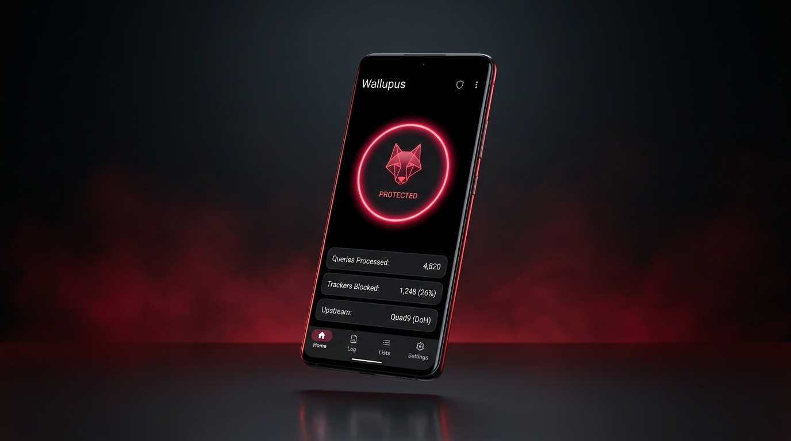
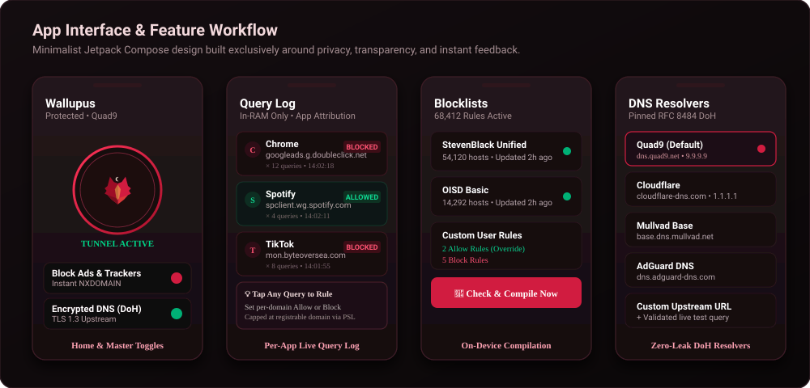
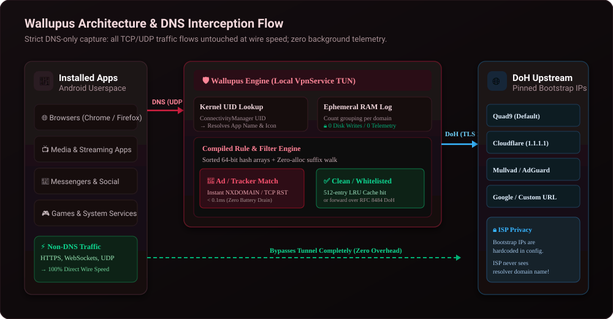
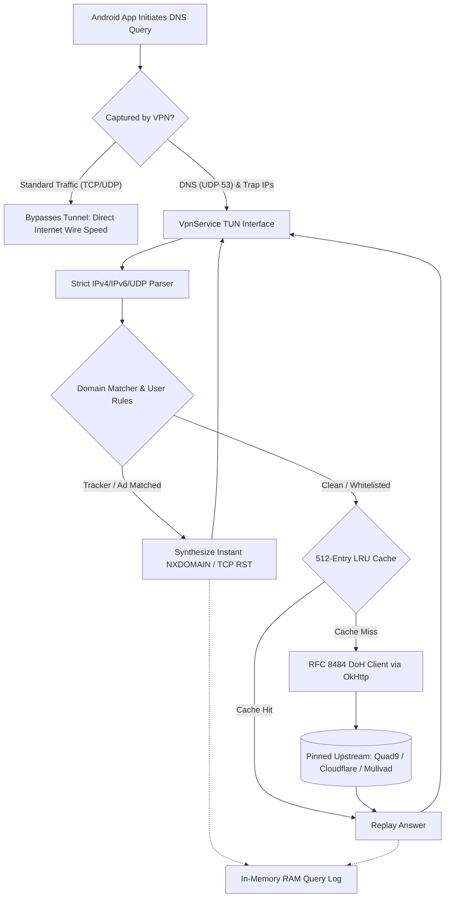

<div align="center">


# Wallupus

**A minimal, uncompromising DNS-only ad and tracker blocker for Android 10+**

*Zero telemetry. In-memory ephemeral logs. Pinned DoH upstreams. Local compilation. ~4,800 lines of clean Kotlin.*

<p>
  
  
  
  
  
  
</p>

---

<p>
  <a href="#-about-wallupus">About</a> •
  <a href="#-key-features">Features</a> •
  <a href="#-visual-tour">Visual Tour</a> •
  <a href="#-system-architecture">Architecture</a> •
  <a href="#-first-run--quick-start">Quick Start</a> •
  <a href="#-configuration">Configuration</a> •
  <a href="#-how-it-works">How It Works</a> •
  <a href="#-building-from-source">Building</a> •
  <a href="#-known-limits">Limits</a> •
  <a href="#-icon--design-philosophy">Design</a> •
  <a href="#-privacy--license">License</a>
</p>

<p align="center">
  
</p>

</div>

---

## 🐺 About Wallupus

**Wallupus** is a lean, transparent, local DNS sinkhole and tracker blocker built for Android 10+ (API 29+). Clocking in at around 4,800 lines of meticulously commented Kotlin, it is compact enough to read, audit, and understand in a single weekend.

Most mobile blockers route all device traffic through heavy local proxy daemons, decrypt TLS sessions, or send lookups to proprietary cloud intermediaries. Wallupus takes a fundamentally different path:

- 🎯 **Captures DNS and nothing else**: The local VPN routes only its two loopback resolver addresses into the app, plus the IPs of known public resolvers (e.g. `8.8.8.8`, `1.1.1.1`) so apps cannot bypass filtering. All TCP and UDP traffic (HTTPS streams, videos, games, downloads) flows directly to the network at full wire speed without touching Wallupus.
- 🔒 **Encrypted Upstream, Your Pick**: Permitted queries travel over DNS-over-HTTPS (RFC 8484) to your preferred resolver: **Quad9** (default), **Cloudflare**, **Cloudflare Security**, **Mullvad**, **Mullvad Base**, **AdGuard**, **Google**, or any custom DoH endpoint. Pinned bootstrap IPs ensure your ISP never observes even the resolver's hostname. An upstream is switched to only after an active live query succeeds.
- 📱 **100% On-Device Compilation**: Filter lists (hosts and Adblock syntax) are compiled and indexed directly on your handset into compact 64-bit hash arrays. No proprietary proxy servers, no telemetry, no crash reporters, and zero TLS interception.
- 🧠 **Zero Traces Leave the Device**: Backups and device-to-device transfers are disabled across every data domain. The query log resides solely in volatile RAM. It consolidates repetitive queries with a live hit counter and attributes lookups to the specific app that made them.

---

## ✨ Key Features

<table>
  <tr>
    <td width="50%">
      <h3>🎯 Pure DNS Interception</h3>
      <p>Only DNS packets enter the tunnel. Web browsing, large file downloads, streaming media, and gaming traffic completely bypass the app, yielding zero battery drain and unthrottled throughput.</p>
    </td>
    <td width="50%">
      <h3>🔒 RFC 8484 DNS-over-HTTPS</h3>
      <p>Encrypted upstream queries with hardcoded bootstrap IPs. Switches upstreams seamlessly without VPN reconnects, protected by automated pre-flight connectivity probes.</p>
    </td>
  </tr>
  <tr>
    <td width="50%">
      <h3>⚡ Zero-Alloc Suffix Matching</h3>
      <p>High-efficiency binary search over sorted 64-bit domain hash tables. Evaluates queries in sub-millisecond time with instant NXDOMAIN synthesized responses and TCP RST generation.</p>
    </td>
    <td width="50%">
      <h3>📱 Per-App Query Attribution</h3>
      <p>Queries kernel socket UIDs to expose exactly which installed apps initiate tracker lookups. Displays app names and icons directly in your local query log.</p>
    </td>
  </tr>
  <tr>
    <td width="50%">
      <h3>🧠 Ephemeral In-Memory Logging</h3>
      <p>Query history lives exclusively in RAM and vanishes on exit. Groups identical lookups, reveals first/last seen timestamps, and lets you craft allow/block rules in a single tap.</p>
    </td>
    <td width="50%">
      <h3>🔄 Resilient Blocklist Engine</h3>
      <p>Automated periodic updates using HTTP conditional GETs (ETag / Last-Modified), a 64&nbsp;MB safety cap, anti-shrink safeguards (&gt;75% drop rejection), and corrupt-safe atomic writes.</p>
    </td>
  </tr>
</table>

---

## 📸 Visual Tour

### Minimalist Compose Interface

Wallupus is crafted with Jetpack Compose following Material 3 guidelines and a custom AMOLED ink-and-crimson palette (`#0E0A0B` and `#D11F40`).

<p align="center">
  
</p>

1. **Home Screen**: A bold, glowing shield button indicates real-time protection state. Independent master switches let you toggle ad/tracker blocking and encrypted DNS separately.
2. **Query Log**: Live feed of domain requests grouped by requesting application. Highlights blocked trackers in crimson and allowed connections in emerald, with one-tap drilldowns to whitelist or blacklist domains.
3. **Blocklists**: Manage filter sources (StevenBlack, OISD, custom URLs), trigger on-device compilation, and view total active rule counts.
4. **DNS Settings**: Switch between curated zero-logging DoH providers or configure a custom DoH endpoint with dedicated bootstrap IPs.

---

## 🏗️ System Architecture

Wallupus operates as a lightweight packet processing engine directly over the Android `VpnService` file descriptor (`tun0`):

<p align="center">
  
</p>

### Packet Lifecycle



1. **Trap Routes**: `WallupusVpnService` configures routes strictly for its synthetic loopback resolvers (`10.254.1.1`, `fd00::1`) and known public DNS anycast IPs (`8.8.8.8`, `1.1.1.1`, etc.).
2. **Packet Loop**: A dedicated worker thread polls the `tun0` file descriptor. Non-DNS payloads receive instant TCP resets (`RST`) or ICMP unreachables.
3. **Domain Evaluation**: The query is extracted without memory allocations and checked against compiled 64-bit hash arrays (`DomainMatcher.kt`). User-defined rules take immediate precedence over subscribed lists.
4. **Upstream Forwarding**: Allowed lookups consult a 512-entry unaged LRU cache. Cache misses are dispatched as RFC 8484 binary POST payloads over OkHttp to the selected DoH resolver.
5. **App Identification**: Android's `ConnectivityManager.getConnectionOwnerUid()` identifies the socket owner in real time, resolved to package metadata via `QUERY_ALL_PACKAGES`.

---

## 🚀 First Run & Quick Start

1. **Activate Protection**: Open Wallupus and tap the center shield button. Accept Android's system VPN prompt. The initial blocklist compilation begins automatically.
2. **Check Private DNS**: Go to **Android Settings → Network & Internet → Private DNS** and ensure it is set to **Off** or **Automatic**. If a specific third-party provider hostname is configured there, Android will route queries around the local VPN; the app will alert you if this condition is detected.
3. **Always-On VPN (Recommended)**: In **Android Settings → Network & Internet → VPN → Wallupus (gear icon)**, enable **Always-on VPN**. This ensures Android automatically restarts Wallupus upon device reboot or memory recovery.

---

## ⚙️ Configuration

### In-App Controls
- **Change Upstream**: Navigate to **Settings** and select any built-in resolver (Quad9, Cloudflare, Mullvad, AdGuard, Google) or enter a custom DoH URL. Upstream changes take effect on the very next query without cycling the VPN.
- **Custom Filtering Rules**: Tap any row in the **Log** tab to open the rule builder. You can whitelist or block specific domains or register root-domain scopes via OkHttp's embedded Public Suffix List.

### In-Source Defaults (`config.json`)
The source configuration is located at `app/src/main/assets/config.json`:
- Pre-configured DoH resolvers and fallback bootstrap IPs.
- Default blocklist subscription URLs.
- App update repository and branch targets.

---

## 🔬 How It Works (Source Map)

The codebase is organized into cleanly decoupled, testable components:

| Module / File | Responsibility |
|---|---|
| [`vpn/WallupusVpnService.kt`](file:///C:/Users/Nihil/Desktop/Gloria%20Repoz/Wallupus/app/src/main/java/dev/wallupus/vpn/WallupusVpnService.kt) | Establishes tunnel interface, fake DNS IPs, and public DNS trap routes; excludes app self-traffic. |
| [`vpn/PacketLoop.kt`](file:///C:/Users/Nihil/Desktop/Gloria%20Repoz/Wallupus/app/src/main/java/dev/wallupus/vpn/PacketLoop.kt) | `poll()` loop over the tun descriptor; blocks yield instant `NXDOMAIN`, TCP gets `RST`, clean hits forward to DoH. |
| [`vpn/Modes.kt`](file:///C:/Users/Nihil/Desktop/Gloria%20Repoz/Wallupus/app/src/main/java/dev/wallupus/vpn/Modes.kt) | Independent states for ad/tracker blocking and encrypted DNS; tunnel stays up while either is enabled. |
| [`net/IpPacket.kt`](file:///C:/Users/Nihil/Desktop/Gloria%20Repoz/Wallupus/app/src/main/java/dev/wallupus/net/IpPacket.kt) | Zero-copy IPv4/IPv6/UDP packet decoder, response constructor, and TCP RST checksum synthesizer. |
| [`dns/DnsMessage.kt`](file:///C:/Users/Nihil/Desktop/Gloria%20Repoz/Wallupus/app/src/main/java/dev/wallupus/dns/DnsMessage.kt) | Strict DNS wire-format parser, compression pointer validator, NXDOMAIN/SERVFAIL generator, and TTL extractor. |
| [`dns/DohClient.kt`](file:///C:/Users/Nihil/Desktop/Gloria%20Repoz/Wallupus/app/src/main/java/dev/wallupus/dns/DohClient.kt) | RFC 8484 POST transport via OkHttp, pinned bootstrap IPs, live upstream hot-swapping, latency probes. |
| [`dns/Resolvers.kt`](file:///C:/Users/Nihil/Desktop/Gloria%20Repoz/Wallupus/app/src/main/java/dev/wallupus/dns/Resolvers.kt) | Active resolver state machine (bundled presets or user custom), persistent settings synchronizer. |
| [`dns/PlainDnsClient.kt`](file:///C:/Users/Nihil/Desktop/Gloria%20Repoz/Wallupus/app/src/main/java/dev/wallupus/dns/PlainDnsClient.kt) | Standard UDP fallback to system DNS servers when encrypted DNS mode is disabled. |
| [`dns/CustomUpstream.kt`](file:///C:/Users/Nihil/Desktop/Gloria%20Repoz/Wallupus/app/src/main/java/dev/wallupus/dns/CustomUpstream.kt) | Validates custom DoH endpoints and bootstrap IPs using pre-flight test queries. |
| [`dns/DnsCache.kt`](file:///C:/Users/Nihil/Desktop/Gloria%20Repoz/Wallupus/app/src/main/java/dev/wallupus/dns/DnsCache.kt) | 512-entry LRU response cache; respects TTL expirations without altering unaged answer wire buffers. |
| [`filter/ListParser.kt`](file:///C:/Users/Nihil/Desktop/Gloria%20Repoz/Wallupus/app/src/main/java/dev/wallupus/filter/ListParser.kt) | Ingests `hosts`, raw domain lists, and Adblock `\|\|domain^` rules with `@@` exception support. |
| [`filter/DomainMatcher.kt`](file:///C:/Users/Nihil/Desktop/Gloria%20Repoz/Wallupus/app/src/main/java/dev/wallupus/filter/DomainMatcher.kt) | Sorted 64-bit hash arrays with zero-allocation suffix walk; custom user rules supersede blocklists. |
| [`filter/CompiledLists.kt`](file:///C:/Users/Nihil/Desktop/Gloria%20Repoz/Wallupus/app/src/main/java/dev/wallupus/filter/CompiledLists.kt) | High-speed binary disk format with atomic file replacements; corrupt files fall back safely to empty state. |
| [`filter/BlocklistUpdater.kt`](file:///C:/Users/Nihil/Desktop/Gloria%20Repoz/Wallupus/app/src/main/java/dev/wallupus/filter/BlocklistUpdater.kt) | Conditional HTTP GET updater, 64&nbsp;MB safety ceiling, stale-cache resilience, empty-response guard. |
| [`filter/SourceCheck.kt`](file:///C:/Users/Nihil/Desktop/Gloria%20Repoz/Wallupus/app/src/main/java/dev/wallupus/filter/SourceCheck.kt) | Integrity verification rejecting error landing pages and rule drops exceeding 75%. |
| [`filter/RuleTargets.kt`](file:///C:/Users/Nihil/Desktop/Gloria%20Repoz/Wallupus/app/src/main/java/dev/wallupus/filter/RuleTargets.kt) | Formulates domain and root-domain targeting options bounded by OkHttp's Public Suffix List. |
| [`filter/UpdateWorker.kt`](file:///C:/Users/Nihil/Desktop/Gloria%20Repoz/Wallupus/app/src/main/java/dev/wallupus/filter/UpdateWorker.kt) | Background WorkManager task: triggers daily on unmetered Wi-Fi and healthy battery state. |
| [`log/QueryGroups.kt`](file:///C:/Users/Nihil/Desktop/Gloria%20Repoz/Wallupus/app/src/main/java/dev/wallupus/log/QueryGroups.kt) | In-memory log grouping key `(app, domain, outcome)` with query hit counts and timestamps. |
| [`log/AppGroups.kt`](file:///C:/Users/Nihil/Desktop/Gloria%20Repoz/Wallupus/app/src/main/java/dev/wallupus/log/AppGroups.kt) | Partitions live queries into per-application sections with domain letter avatars and color accents. |
| [`ui/AppLabels.kt`](file:///C:/Users/Nihil/Desktop/Gloria%20Repoz/Wallupus/app/src/main/java/dev/wallupus/ui/AppLabels.kt) | Memory-cached package name and icon resolution for raw socket UIDs. |
| [`update/AppUpdater.kt`](file:///C:/Users/Nihil/Desktop/Gloria%20Repoz/Wallupus/app/src/main/java/dev/wallupus/update/AppUpdater.kt) | On-demand GitHub Release updater: validates payload size, downloads APK, and triggers package installer. |

---

## 🛠️ Building from Source

Wallupus compiles cleanly from the command line using standard Gradle and the Android Command-Line Tools—no Android Studio installation required.

### Prerequisites (Windows CLI)

1. **JDK 17**:
   ```powershell
   winget install EclipseAdoptium.Temurin.17.JDK
   ```

2. **Android Command-Line Tools**:
   Download the Command Line Tools package from [developer.android.com/studio](https://developer.android.com/studio). Extract to:
   ```powershell
   $env:LOCALAPPDATA\Android\Sdk\cmdline-tools\latest\bin\sdkmanager.bat
   ```

3. **Install Android SDK Components**:
   ```powershell
   $env:ANDROID_HOME = "$env:LOCALAPPDATA\Android\Sdk"
   [Environment]::SetEnvironmentVariable("ANDROID_HOME", $env:ANDROID_HOME, "User")
   & "$env:ANDROID_HOME\cmdline-tools\latest\bin\sdkmanager.bat" "platform-tools" "platforms;android-35" "build-tools;35.0.0"
   & "$env:ANDROID_HOME\cmdline-tools\latest\bin\sdkmanager.bat" --licenses
   ```

### Compile & Install

1. **Run Unit Tests & Assemble Debug APK**:
   ```powershell
   .\gradlew.bat test assembleDebug
   ```
   The generated APK will be placed at:
   ```
   app\build\outputs\apk\debug\app-debug.apk
   ```

2. **Install to Connected Device**:
   Enable USB debugging on your device, then install via ADB:
   ```powershell
   & "$env:ANDROID_HOME\platform-tools\adb.exe" install -r app\build\outputs\apk\debug\app-debug.apk
   ```

> [!NOTE]
> Debug builds are registered under the package ID `dev.wallupus.debug` ("Wallupus Dev"). They install side-by-side with production release builds, allowing rapid testing without overwriting production settings.

---

### Supply Chain Verification

Lock build dependencies using Gradle verification metadata to guarantee that no upstream library artifact has been modified:

```powershell
.\gradlew.bat --write-verification-metadata sha256 assembleDebug test
```

Ensure `distributionSha256Sum` is specified in `gradle/wrapper/gradle-wrapper.properties` matching the official checksum from `gradle.org`.

---

### Generating a Signed Release Build

1. **Generate an Elliptic-Curve Keystore**:
   ```powershell
   keytool -genkeypair -v -keystore wallupus.jks -keyalg EC -groupname secp256r1 -validity 10000 -alias wallupus
   ```

2. **Configure Keystore Properties**:
   Create a `keystore.properties` file in the project root (this file is excluded by `.gitignore`):
   ```properties
   storeFile=wallupus.jks
   storePassword=your_store_password
   keyAlias=wallupus
   keyPassword=your_key_password
   ```

3. **Build the Release Package**:
   ```powershell
   .\gradlew.bat assembleRelease
   ```

---

### Automated Releases (GitHub Actions)

Every commit to `main` triggers `.github/workflows/release.yml`: executing test suites, packaging a signed release APK, and publishing a GitHub Release tagged `v0.1.<commit_count>`.

Configure repository secrets via GitHub CLI:

```powershell
[Convert]::ToBase64String([IO.File]::ReadAllBytes("wallupus.jks")) | gh secret set KEYSTORE_BASE64
gh secret set KEYSTORE_PASSWORD
gh secret set KEY_ALIAS
gh secret set KEY_PASSWORD
```

---

## ⚠️ Known Limits

DNS-level filtering provides remarkable speed and battery efficiency, but comes with specific technical trade-offs:

- **Same-Domain Advertisements**: First-party ads sharing the same domain as primary content (e.g. YouTube video ads, Instagram sponsored posts, Reddit promoted feed entries) cannot be blocked without TLS proxying or DOM manipulation.
- **Hardcoded DoH by Direct IP**: Wallupus traps standard port 53 traffic and known public resolver IPs (`8.8.8.8`, `1.1.1.1`, etc.). Apps that query unlisted, hardcoded third-party DoH IPs directly will bypass interception.
- **Client-Side DNS Caching**: Android and individual browser runtimes maintain internal DNS caches. Repeated lookups served from internal client caches inside their TTL will not register in the Wallupus query log.
- **Single VPN Slot**: Android permits only one active `VpnService` at a time. Wallupus cannot be chained alongside another active VPN client.
- **Non-DNS Traffic to Trapped Resolver IPs**: Because trapped resolver IPs are redirected strictly to the local DNS loop, ICMP pings and non-DNS socket connections to `8.8.8.8` or `1.1.1.1` will not respond while the tunnel is active.

---

## 🎨 Icon & Design Philosophy

<p align="center">
  
</p>

> *"A geometric she-wolf poised beneath a crescent moon—vigilant, untamed, and self-contained."*

The visual identity of Wallupus reflects its architecture:
- **Palette Ink (`#0E0A0B`)**: Deep obsidian canvas, calibrated for true-black AMOLED power savings and zero visual distraction.
- **Crimson Facets (`#D11F40` & `#9E1028`)**: Sharp geometric polygons representing active protection, precision filtering, and firewall enforcement.
- **Crescent Moon (`#FFF3D9DC`)**: A subtle nod to quiet, round-the-clock background operation that never intrudes on user activity.

---

## 📜 Privacy & License

### Zero-Telemetry Guarantee
- **No Cloud Services**: Wallupus has no backend servers. All list compilation, caching, and evaluation occur on your physical device.
- **No Trackers**: Zero telemetry SDKs, no Google Analytics, no Firebase Crashlytics, and no Sentry.
- **No TLS Interception**: Your encrypted HTTPS web traffic is never decrypted, modified, or proxied.

### License
Wallupus is open-source software licensed under the **[MIT License](LICENSE)** (or equivalent project terms). All third-party dependencies are acknowledged under their respective open-source licenses.
